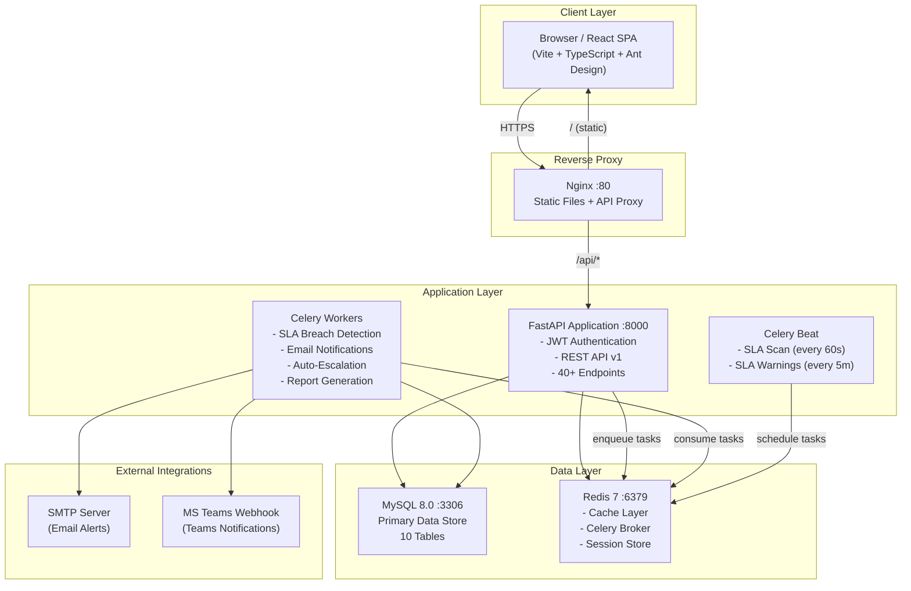

# ITSM & Project Management Platform - Features & Architecture

## Architecture Diagram



## ASCII Architecture Diagram

```
┌──────────────────────────────────────────────────────────────┐
│                    CLIENT (Browser)                          │
│              React + Vite + TypeScript + Ant Design          │
│         Dashboard | Tickets | SLA | Users | Audit            │
└───────────────────────────┬──────────────────────────────────┘
                            │ HTTPS
                            ▼
┌──────────────────────────────────────────────────────────────┐
│                  NGINX Reverse Proxy (:80)                   │
│           /api/* → FastAPI    |    /* → React Static         │
└─────────────┬──────────────────────┬─────────────────────────┘
              │                      │
              ▼                      ▼
┌─────────────────────────┐  ┌───────────────────────┐
│   FastAPI App (:8000)   │  │  React Static Files   │
│   ┌───────────────────┐ │  │  (Built by Vite)      │
│   │ JWT Auth          │ │  └───────────────────────┘
│   │ REST API v1       │ │
│   │ 40+ Endpoints     │ │
│   │ Role-Based Access │ │
│   └───────────────────┘ │
└────┬──────────┬─────────┘
     │          │
  ┌──┘    ┌────┘          ┌────────────────────────┐
  │       │               │                        │
  ▼       ▼               ▼                        ▼
┌─────┐ ┌─────┐    ┌────────────┐          ┌────────────┐
│MySQL│ │Redis│    │ Celery     │          │ Celery     │
│ 8.0 │ │  7  │    │ Workers    │          │ Beat       │
│:3306│ │:6379│    │ ┌────────┐ │          │ ┌────────┐ │
│     │ │     │    │ │SLA Scan│ │          │ │Every   │ │
│ 10  │ │Cache│    │ │Email   │ │          │ │60s SLA │ │
│Tables│ │Broker│   │ │Escalate│ │          │ │5m Warn │ │
│     │ │     │    │ │Reports │ │          │ └────────┘ │
└─────┘ └─────┘    │ └────────┘ │          └────────────┘
                   └──────┬─────┘
                     ┌────┴────┐
                     │         │
                     ▼         ▼
              ┌──────────┐ ┌──────────┐
              │  SMTP    │ │ MS Teams │
              │  Server  │ │ Webhook  │
              └──────────┘ └──────────┘
```

## Container Architecture (Docker Compose)

| Container | Image | Port | Purpose |
|-----------|-------|------|---------|
| `itsm-mysql` | mysql:8.0 | 3306 | Primary database |
| `itsm-redis` | redis:7-alpine | 6379 | Cache + message broker |
| `itsm-backend` | python:3.12-slim | 8000 | FastAPI REST API |
| `itsm-celery-worker` | python:3.12-slim | - | Background task processor |
| `itsm-celery-beat` | python:3.12-slim | - | Periodic task scheduler |
| `itsm-nginx` | nginx:alpine | 80 | Reverse proxy + static files |

---

## Phase 1 - Core Team & Task Tracking (MVP)

### User Management
- **User CRUD** - Create, read, update, deactivate users
- **Role-Based Access Control** - 4 roles with different permissions:
  - **Admin**: Full system access, user management, configuration
  - **Manager**: Team management, reporting, SLA configuration
  - **Engineer**: Ticket assignment, status updates, comments
  - **Viewer**: Read-only access to tickets and dashboards
- **JWT Authentication** - Secure access/refresh token authentication
- **Password Management** - Secure bcrypt hashing, password change

### Team Management
- Create and manage teams with descriptions
- Assign team leads
- Add/remove team members (many-to-many relationship)
- View team member list with details

### Project Management
- Create projects with unique keys (e.g., INFRA, DEVOPS)
- Project keys used for auto-generated ticket numbers (INFRA-001)
- Archive/activate projects
- Assign project leads

### Issue/Ticket Tracking
- **Create tickets** with title, description, priority, assignee, team
- **Auto-generated ticket numbers** from project key + sequence
- **Priority levels**: P1 (Critical), P2 (High), P3 (Medium), P4 (Low)
- **Server-enforced status workflow**:
  ```
  Open → In Progress → Blocked → Resolved → Closed
                    ↑           ↓
                    +-----------+
  ```
  - Invalid transitions are rejected with clear error messages
- **Comments** on tickets (public and internal notes)
- **First response tracking** - automatically recorded when assignee comments
- **Filtering** - by status, priority, assignee, project, search text
- **Pagination** - configurable page size with total counts

---

## Phase 2 - SLA & Performance Tracking

### SLA Configuration
- Define SLA policies per priority level:
  - **P1**: 15 min response, 1 hr resolution
  - **P2**: 1 hr response, 4 hr resolution
  - **P3**: 8 hr response, 24 hr resolution
  - **P4**: 24 hr response, 72 hr resolution
- Project-specific SLA overrides
- Default global SLA policies
- Create custom SLA policies

### SLA Monitoring
- **Auto-created SLA records** when tickets are created
- **Response time tracking** - triggered on first assignee comment
- **Resolution time tracking** - triggered on status → Resolved
- **Breach detection** - Celery Beat scans every 60 seconds
- **Warning notifications** - 15-minute advance warning before breach
- **Breach status**: Met / Breached / Pending

### KPI Dashboard
- **Overview cards**: Total tickets, open, SLA compliance %, avg resolution time
- **Tickets by status** - bar chart with color-coded statuses
- **Tickets by priority** - horizontal bar chart (P1-P4)
- **SLA compliance** - donut chart (met vs breached)
- **Compliance by priority** - bar chart showing % per priority level
- **MTTR (Mean Time To Resolve)** - min, avg, max by priority
- **Engineer performance table**:
  - Tickets assigned / resolved
  - Average resolution time
  - SLA compliance percentage
- **Team performance** - aggregate metrics per team

---

## Phase 3 - Advanced Enterprise Features

### Notifications
- **In-app notifications** - bell icon with unread count, auto-refresh every 30s
- **Email alerts** - SMTP integration for SLA breaches
- **MS Teams webhooks** - Adaptive card notifications to Teams channels
- **Notification types**: SLA breach, SLA warning, assignment, status change, escalation
- **Mark read** - individual or bulk mark-all-read

### Escalation Rules
- **Configurable rules** per project and priority
- **Trigger types**: Response breach, resolution breach, approaching breach
- **Auto-reassignment** - automatically reassign ticket to escalation target
- **Multi-channel alerts** - email + Teams on breach
- **Audit trail** - escalation actions logged for compliance

### Audit & Compliance
- **Full change log** - who changed what, when, with old/new values (JSON diff)
- **Entity-level audit trail** - complete history for any ticket/user/project
- **Compliance report export**:
  - **PCI DSS** - Payment Card Industry compliance
  - **ISO 27001** - Information security management
  - **SOC 2** - Service Organization Control
- **CSV export** with timestamp, user, entity, action, changes
- **Filterable** by entity type, action, user, date range

---

## Database Schema (10 Tables)

| Table | Records | Purpose |
|-------|---------|---------|
| `roles` | 4 | Admin, Manager, Engineer, Viewer |
| `users` | N | User accounts with role assignment |
| `teams` | N | Team definitions |
| `team_memberships` | N | Many-to-many users ↔ teams |
| `projects` | N | Project definitions with unique keys |
| `tickets` | N | Issue/task tracking with status workflow |
| `comments` | N | Ticket comments (public + internal) |
| `sla_policies` | N | SLA time definitions per priority |
| `sla_records` | N | Per-ticket SLA tracking (1:1 with tickets) |
| `escalation_rules` | N | Auto-escalation configuration |
| `notifications` | N | In-app/email/Teams notifications |
| `audit_logs` | N | Complete change audit trail |

---

## API Endpoints (40+)

| Group | Endpoints | Auth |
|-------|-----------|------|
| Health | `GET /health`, `GET /health/detailed` | No / Admin |
| Auth | Login, refresh, me, password change | No / Yes |
| Users | CRUD + list with filters | Admin, Manager |
| Teams | CRUD + member management | Admin, Manager |
| Projects | CRUD + archive | Admin, Manager |
| Tickets | CRUD, status transition, assign, comments | All roles |
| SLA | Policy CRUD, records, breaches | Admin, Manager |
| Dashboard | Overview, status/priority charts, MTTR, engineer/team performance | All roles |
| Notifications | List, unread count, mark read | All roles |
| Escalation | Rule CRUD | Admin, Manager |
| Audit | Log query, entity trail, compliance export | Admin, Manager |

---

## Technology Stack

| Layer | Technology | Version |
|-------|-----------|---------|
| Backend | Python FastAPI | 0.115.0 |
| Database | MySQL | 8.0 |
| ORM | SQLAlchemy (async) | 2.0.35 |
| Migrations | Alembic | 1.13.3 |
| Cache/Broker | Redis | 7 |
| Task Queue | Celery | 5.4.0 |
| Auth | JWT (python-jose) | 3.3.0 |
| Frontend | React + TypeScript | 18.3 |
| Build Tool | Vite | 5.4 |
| UI Library | Ant Design | 5.20 |
| Charts | Recharts | 2.12 |
| Data Fetching | TanStack React Query | 5.56 |
| HTTP Client | Axios | 1.7 |
| Reverse Proxy | Nginx | Alpine |
| Container | Docker + Docker Compose | 3.8 |
